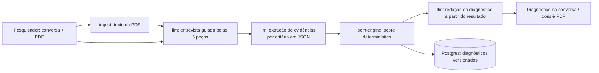

# Arquitetura

## Visão geral do fluxo de diagnóstico

## Princípios

1. **O LLM conversa, extrai e redige. Quem dá a nota é o código.** O score vem da rubrica versionada (`scm-engine`), nunca de um número gerado pelo modelo. Ver ADR 0001.
2. **Rastreabilidade.** Toda evidência guarda os trechos da conversa ou do PDF que a sustentam. Todo diagnóstico guarda a versão da rubrica e dos prompts usados.
3. **Comparabilidade.** Projetos avaliados com a mesma versão da rubrica são comparáveis. É isso que viabiliza o benchmark de portfólio para NITs.
4. **Calibração contínua.** A pasta `evals/` mede a concordância entre a IA e a avaliação da especialista a cada mudança de prompt ou rubrica.
5. **LGPD por padrão.** Projetos de pesquisa podem conter segredo industrial e dados pessoais. Ver `docs/lgpd.md`.

## Pacotes

| Pacote | Responsabilidade | Status |
|---|---|---|
| `scm-engine` | Uma peça por arquivo, tabuleiro com pesos e regras entre peças, fontes científicas | v0.2 com base científica |
| `llm` | Abstração do provedor, prompts versionados, saída estruturada validada por schema | a fazer |
| `ingest` | PDF → texto segmentado, com referência de página | a fazer |
| `reports` | Dossiê por projeto e relatório de portfólio | a fazer |
| `db` | Schema: usuários, organizações (NITs), projetos, conversas, evidências, diagnósticos | a fazer |

## Fluxo B2B (NITs)

Upload em lote → fila de jobs → para cada projeto: ingest → extração → score → dossiê. Sem conversa ao vivo, as lacunas viram "perguntas pendentes" que o NIT pode encaminhar ao pesquisador.

## Roadmap sugerido para a Fase 3

1. **Núcleo do método:** rubrica oficial validada pela Dandara + `scm-engine` + testes.
2. **Diagnóstico B2C de ponta a ponta:** migrar o chat atual para o fluxo extração → score → redação.
3. **Evals:** 10 a 20 projetos-gabarito e métrica de concordância IA × especialista.
4. **Piloto NIT:** upload de portfólio, processamento em lote, benchmark e dossiê PDF.
5. **Endurecimento:** LGPD, logs de auditoria, controle de custo de LLM, monitoramento.
